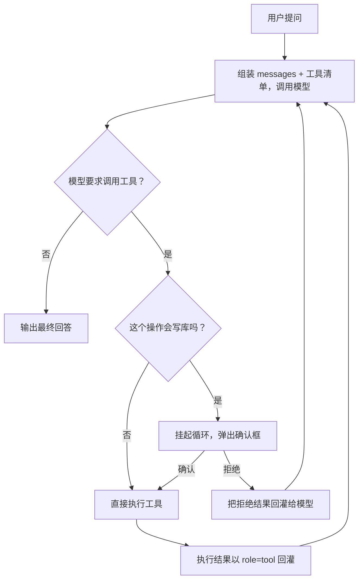

# 订单智能助手（Order Agent）

> 一个"能办事"的智能体示例：**从零手写 agent loop**，不依赖任何框架；
> 同时提供一份 **LangChain 1.x 重写版**做对照。
>
> 它不只"说"，还能"做"——通过工具读写真实数据库：查订单、算总消费、取消订单、改收货地址
> （写操作一律先弹确认，确认后才执行）；也能检索售后政策知识库（RAG）回答政策问题。

**技术栈**：Python + Streamlit + SQLite + RAG（embedding API + 余弦检索）+ 大模型 API（OpenAI 兼容端点：智谱 GLM / 阿里百炼 / DeepSeek / 硅基流动均可）

**为什么叫"智能体"而不是"客服机器人"**：客服是"说"的闭环，智能体是"说 + 做"的闭环——模型能通过工具碰到真实数据、改变系统状态。这个项目把"做"的部分完整做出来了，包括"该不该做"的判断。

---

## 它是怎么跑的



**模型只负责"提议"，执行权始终在代码手里**；写库操作不直接执行，先把循环挂起、等用户点确认后再继续 ——
这两条是整个项目最核心的设计，对应下面「五个关键设计」的第 1 条和第 3 条。

---

## 它能做什么

| 你问它 | 它的行为 | 关键点 |
|---|---|---|
| "查询用户 u001 的订单" | 调 `get_user_orders` | 模型"看到"工具并调用 |
| "u001 总共消费了多少钱" | **连续调两次** `get_user_orders`，自己求和 | 多步工具调用的完整闭环 |
| "退货的话运费谁承担？" | 调 `search_knowledge_base` 向量检索，按原文回答 | **RAG**：语义检索命中政策（换个问法也找得到） |
| "帮我取消订单 o1003" | 调 `cancel_order` → **弹确认框** → 确认后才执行 | 危险操作确认机制 |
| "把 o1003 的地址改成……" | 调 `update_address` → 弹确认框 → 状态机校验（已发货不给改） | 第二种危险操作 + 业务校验 |

界面会**逐步展示模型调用工具的全过程**（调了什么、参数是什么、返回了什么），
左侧边栏可以实时查看数据库——取消订单后去看 orders 表，**状态真的变了**。

## 快速开始

### 1. 获取 API Key（四选一，推荐 A）

**方式 A · 阿里云百炼（新用户有免费额度）**
1. 打开 https://bailian.console.aliyun.com ，注册并**实名认证**
2. 右上角 **API-KEY** → 创建 Key（`sk-` 开头）
3. 新用户可领免费 token 额度（qwen-turbo / qwen-plus 均有）

**方式 B · DeepSeek**：https://platform.deepseek.com 创建 Key，充值 10 元够用很久

**方式 C · 硅基流动 SiliconFlow**：https://siliconflow.cn 注册送 2000 万 token 额度

**方式 D · 智谱 GLM**：https://open.bigmodel.cn 创建 Key（本项目当前用这个）

> 只要厂商提供 **OpenAI 兼容端点**，改 `.env` 里的 `LLM_BASE_URL` / `LLM_MODEL` 即可切换，代码零改动。

### 2. 配置并运行

**Windows 一键版**：双击 `run.bat`。它会自己检查/创建 `.venv`、缺依赖就装、重置数据、再拉起界面 ——
全程都用项目内的解释器，从根上避免"装到 A 却用 B 跑"这种问题。

**手动版**（任意平台）：

```bash
python -m venv .venv                  # 建独立环境
.venv\Scripts\activate                # Windows；macOS/Linux 用 source .venv/bin/activate
pip install -r requirements.txt
cp .env.example .env                  # 打开 .env，填入你的 API Key（四选一，其余注释掉）

python -m streamlit run app.py        # 启动界面：左侧边栏可切换「手写版 / LangChain 版」
python smoke_test.py                  # 自检（手写版）：三类对话 + 自动重置数据库
python smoke_test_langchain.py        # 自检（框架版）：含"拒绝 / 确认"两条确认链路验证
```

> 首次运行会自动创建 `data/orders.db`（3 个用户、8 笔订单）并构建知识库向量缓存。
> 需要把数据恢复到初始状态时，跑一次 `python -m agent.db` 即可（只重置数据，不调用模型，不花钱）。

**为什么用 `python -m streamlit` 而不是裸 `streamlit`**：裸命令走的是 **PATH 里第一个** streamlit，
很容易和你 `pip install` 的那个 Python 不是同一个 —— 本项目就踩过：系统 Python 装的是 `streamlit`，
但 `langchain` 装在了 venv 里，于是 `streamlit run app.py` 报 `ModuleNotFoundError: No module named 'langchain'`，
**看起来像代码 bug，实际是解释器选错**。自查一行：`python -c "import sys, langchain; print(sys.executable)"`。

## 项目结构

```
agent-lab/
├── run.bat                 # Windows 一键启动（自动建 venv / 补依赖 / 重置数据 / 拉起界面）
├── app.py                  # Streamlit 界面（两版共用；侧边栏切换实现方式）
├── agent/
│   ├── db.py               # 数据层：SQLite 建表 + 造数 + 查询/取消/改地址函数
│   ├── kb.py               # 知识库层：RAG 向量检索（embedding + 余弦 + 关键词兜底）
│   ├── tools.py            # 工具层：JSON Schema 定义 + 分发表 + 危险操作名单
│   ├── core.py             # 核心：手写版 AgentSession 行动循环 + 确认机制 + 轮数保险丝
│   └── langchain_session.py# 框架版会话封装：create_agent + 界面版确认机制（接口与 core 一致）
├── langchain_demo.py       # LangChain 版命令行入口（同一功能的 CLI 形态）
├── smoke_test.py           # 手写版自检脚本
├── smoke_test_langchain.py # 框架版自检脚本
├── probe_provider.py       # 选型探测：厂商是否支持 Function Calling / 有没有 embedding 接口
├── phase1_chat.py          # 最小示例：纯对话调用（不含工具），用于看清"没有工具的模型"长什么样
├── phase2_tools.py         # 最小示例：CLI 版单工具智能体
├── data/orders.db          # 运行时生成
├── data/kb_vectors.json    # 运行时生成的知识库向量缓存
├── requirements.txt
├── .gitignore
└── .env.example            # Key 模板（占位符，不含真 Key）
```

## 双实现的对照

同一个订单智能体有**两份实现**，数据层与知识库层完全复用，只换编排层。
两版跑在同一个 Streamlit 页面里，侧边栏一键切换，各自的对话上下文独立保留。

| | 手写版（`agent/core.py`） | LangChain 版（`agent/langchain_session.py`） |
|---|---|---|
| 工具定义 | 手写 JSON Schema 字典 | `@tool` 装饰器自动生成 |
| 行动循环 | 自己写 while + 回灌（约 150 行） | `create_agent` 一行（底层 LangGraph 状态机） |
| 轮数保险丝 | `MAX_ROUNDS` 常量 | `recursion_limit` 运行时配置 |
| 结果回灌 | 手动 append `role="tool"` | 框架自动完成 |
| 确认机制 | **循环真正挂起**，等用户点按钮后再继续 | 界面层无法阻塞 → 「**预演 → 确认 → 重放**」 |
| 事件来源 | 循环里手动 append | 读 `messages` 里的 `tool_calls` / `ToolMessage` |

先手写一遍，再用框架重写同一个应用，才能讲清楚**框架替你省掉了什么、又拿走了什么**。

### 实现中遇到的三个坑

1. **确认机制拿不到"挂起"**：手写版循环在自己手里，遇到危险工具直接 `return`，想停就停；
   LangChain 版在界面里不能像 CLI 那样用 `input()` 阻塞，于是改成"工具先只登记不执行，
   用户点确认后由会话层执行、再把结果回灌"。想做到真正的挂起/恢复，框架侧要用
   `create_agent(interrupt_before=["tools"])` + `checkpointer` + `thread_id` 的 resume 流程。
   —— **框架给你便利，也拿走一部分控制权。**

2. **事件别从回调里抠**：一开始用 `CallbackHandler` 的 `on_tool_start/on_tool_end` 旁听，
   结果拿到的 `input_str` 是 **Python repr 字符串**（单引号，偶发流式分片导致的重复调用/脏 key），
   用它渲染"工具参数"还得先做字符串解析。后来改成直接读返回的 `messages` ——
   `AIMessage.tool_calls` 本来就是结构化 dict，`ToolMessage` 带 `name` + `content`。
   —— **框架已经把结构给你了，就别再去解析字符串。**
   （回调机制没白学：生产环境接 Langfuse / LangSmith 做追踪用的是同一套钩子。）

3. **可选依赖不能拖死主功能**：框架版依赖 `langchain`，一旦环境没装，
   `from agent.langchain_session import ...` 抛异常会**整页崩掉**——连根本不依赖它的手写版都打不开。
   改法是把导入包进 `try/except`，用一个 `LANGCHAIN_READY` 开关**动态决定侧边栏里出不出现"框架版"这一项**，
   缺失时只显示一句"装依赖后刷新即可"。**宁可少一个对照版本，也不能让主功能开不了。**

   这次的真实触发场景是：`streamlit` 装在系统 Python 里、`langchain` 装在别处，
   `streamlit run app.py` 用的是前者，于是报 `ModuleNotFoundError: No module named 'langchain'`
   —— **看着像代码 bug，其实是解释器选错**。两边的防线是：`run.bat` 统一走项目内 `.venv`，
   代码侧再做优雅降级。**"改代码"只是兜底，"让它不容易被用错"才是根治。**

## 五个关键设计

1. **工具层（`tools.py`）**：`TOOLS` 是 JSON Schema —— 模型只"看到说明书"，只能提议调用；
   `TOOL_DISPATCH` 是名字→函数的映射 —— **执行权永远在代码手里**，模型碰不到函数本体。
2. **行动循环（`core.py` 的 `AgentSession.send`）**：while 循环里，模型提议 → 代码执行 →
   结果以 `role="tool"` 回灌 → 模型继续，直到不再请求工具、输出最终回答。带轮数保险丝（`MAX_ROUNDS`）防死循环。
3. **危险操作确认（`CONFIRM_REQUIRED`）**：写操作（`cancel_order` / `update_address`）不直接执行，
   循环**挂起**，等用户点"确认执行 / 拒绝"再继续 —— 对应 LangGraph 的 human-in-the-loop 机制。
4. **RAG 知识库（`kb.py`）**：离线建库（FAQ → embedding 向量 → JSON 缓存）+ 在线检索
   （问题向量化 → 余弦相似度 top-k）。故意不用向量数据库，让检索原理保持透明；
   embedding API 不可用时自动降级关键词匹配（外部依赖要有降级路径）。
   **对智能体来说 RAG 就是一个检索工具** —— 挂进工具层，循环零改动。
5. **业务校验放在数据层**：改地址 / 取消都要过"状态机守卫"（只有待发货可以），
   校验不靠提示词约束 —— **绝不相信模型的输出正确性**。

## 工程上的几点做法

- **依赖下限从代码用法倒推**。自查时发现 `requirements.txt` 里写的是 `streamlit>=1.36.0`，
  但代码用了 `captions=` 和 `width="stretch"` —— 这两个 1.46 才有。依赖下限写松了，
  别人 clone 下来就会装出一个跑不动的环境。现在下限按实际用法写，上限挡在大版本前，并附实测版本快照。
- **关键路径留自检脚本**。`smoke_test*.py` 覆盖三类对话 + 两条确认链路（拒绝 / 确认），
  clone 下来一条命令就能自己验证环境通不通，不用先读懂全部代码。
- **外部依赖必须有降级路径**。embedding 服务不可用 → 自动退到关键词检索，精度下降但服务不中断；
  可选依赖缺失 → 只隐藏对应功能，不拖垮整页。
- **密钥管理**：真实 Key 只放在 `.env`（已在 `.gitignore` 中），代码一律用 `os.getenv()` 读取，
  仓库内只保留 `.env.example` 占位模板。提交前用 `git status` 再过一眼。
